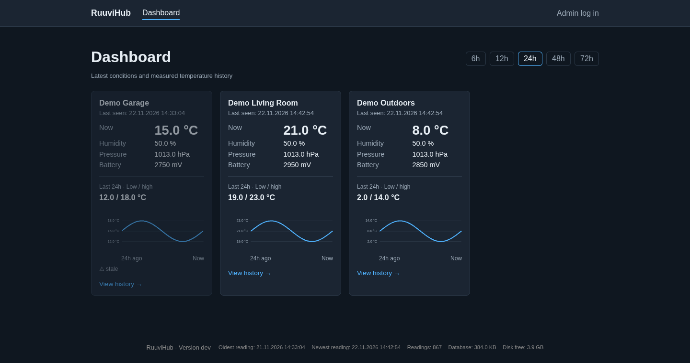

# RuuviHub

RuuviHub is a small always-on service (designed to run on a Raspberry Pi,
but works anywhere Python runs) that:

1. **Scans** [RuuviTag](https://ruuvi.com/) BLE sensors on a schedule and
   stores every reading locally in SQLite.
2. **Uploads** stored readings to a cloud endpoint of your choice on a
   separate schedule (off by default — you turn it on once you've
   configured and tested an endpoint).
3. Serves an embedded **web dashboard** (no separate install) so you can
   see live readings, browse history per sensor, and change settings
   from a browser — no restart required for most changes.

All three of the above run as independent tasks in one process: a crash
or hiccup in one (e.g. the cloud endpoint being down) never stops the
others (see [README-dev.md](README-dev.md) for how).

RuuviHub is licensed under the [MIT License](LICENSE). Bundled third-party
code retains the notices listed in [THIRD_PARTY_NOTICES.md](THIRD_PARTY_NOTICES.md).

## Install and update

Choose your platform below. Release installs need no Git checkout or development
setup. You need a Bluetooth LE adapter, Bluetooth turned on, and RuuviTags in range.

### Windows 11 (64-bit)

1. Open the [latest release](https://github.com/TeemuTikka/ruuvihub/releases/latest)
   and download **`ruuvihub-vX.Y.Z-windows-x64.exe`** from **Assets**
   (`vX.Y.Z` is the release version).
2. Run the installer while signed in to the Windows account that will use
   RuuviHub. Python is included. Setup needs internet access to verify the
   release. Windows may show an unknown-publisher warning; use the installer
   from this project's release page.
3. Open **https://localhost:8443**, or use **Open dashboard** from the
   RuuviHub tray icon (check the taskbar's hidden icons).

RuuviHub runs under your signed-in account and scanning pauses when you sign
out. Settings and readings are kept in `%LOCALAPPDATA%\RuuviHub`.

**Update:** open PowerShell under the same Windows account and run:

```powershell
& "$env:LOCALAPPDATA\Programs\RuuviHub\ruuvihub-update.cmd" update
```

The updater verifies the release and backs up settings and readings before
switching versions. See the [Windows guide](README-windows.md) for status,
revert, uninstall, and troubleshooting instructions.

### Raspberry Pi

Use a Pi with **64-bit Raspberry Pi OS**, **Python 3.11+**, and internet access.

1. Download **`ruuvihub-pi-bootstrap.pyz`** from the
   [latest release](https://github.com/TeemuTikka/ruuvihub/releases/latest)
   to the Pi, then open a terminal in the folder containing it.
2. On a **new installation**, run the following. Replace `pi` with your
   existing Pi username:

   ```bash
   sudo apt update
   sudo apt install bluetooth bluez python3-venv python3-cryptography
   sudo /usr/bin/python3 -I ./ruuvihub-pi-bootstrap.pyz --fresh --user pi
   ```

3. Open **`https://<pi-ip>:8443`** from a browser on the same network,
   replacing `<pi-ip>` with your Pi's IP address. RuuviHub starts
   automatically at boot as `ruuvihub.service`.

The installer downloads and verifies the release. Settings, readings, logs,
and certificates are stored under `/opt/ruuvihub/shared/data/`.

**Update:** on the Pi, run:

```bash
sudo /usr/bin/python3 -Es /opt/ruuvihub/tools/pi_update.py update
```

Already installed using `install.sh`? Follow the
[existing-install migration steps](README-pi.md#switch-an-existing-install-to-the-signed-updater)
before using this updater. The [Pi guide](README-pi.md) also covers status,
revert, legacy archive updates, and troubleshooting.

### First login (both platforms)

- Accept the self-signed certificate warning when opening your own
  RuuviHub dashboard for the first time.
- Sign in with username **`admin`** and password **`ruuvihub`**, then open
  **Settings → System settings** and change the password.
- Nearby sensors appear after a scan cycle. Use System settings to name
  sensors or limit which tags are collected; use Dashboard settings to
  choose visible sensors and measurements.
- Cloud uploading is **off by default**. Configure and test a destination
  before enabling it under **System settings → Cloud Upload**.

The dashboard and sensor history are viewable by anyone on your local network.
Run RuuviHub on a trusted home/local network; do not expose it directly to the
internet.

## Dashboard preview



*Dashboard with synthetic demo readings.*

## Documentation

| Guide | Description |
|---|---|
| [README-windows.md](README-windows.md) | Windows installation, updates, troubleshooting, and development |
| [README-pi.md](README-pi.md) | Raspberry Pi installation, updates, service management, and legacy installs |
| [README-dev.md](README-dev.md) | Development quick start, VS Code, AI agents, architecture, tests, and debugging |
| [CONTRIBUTING.md](CONTRIBUTING.md) | Contribution workflow and pull requests |
| [SECURITY.md](SECURITY.md) | Private vulnerability reporting and deployment security assumptions |
| [THIRD_PARTY_NOTICES.md](THIRD_PARTY_NOTICES.md) | Attribution and license texts for bundled third-party code and adapted skills |

For code changes, jump to [Development](#development) below. The following
sections describe the dashboard and settings shared by both platforms.

## The web dashboard

| Page | URL | What it does |
|---|---|---|
| Dashboard | `/` | Public, read-only card grid of selected sensors' latest readings, refreshing automatically (poll interval configurable, default 300s). Cards show a friendly name (if you've set one) or the raw MAC address. |
| Sensor history | `/sensor/<mac>` | Public weather-style history for one tag: latest temperature/humidity/pressure and charts from oldest on the left to newest on the right. It offers the dashboard windows plus 14, 30, 180, and 360 days and defaults to 3 days. CSV exports include the raw readings, including battery voltage. |
| System settings | `/config` | Admin login required. Change scanning, tag whitelist, retention, cloud upload, history backfill, friendly names, and your login/password. Most changes apply on the next scan/upload cycle — no restart needed. |
| Dashboard settings | `/config/dashboard` | Admin login required. Select visible sensors and measurements, refresh interval, and storage information in the footer. Saves independently of system settings. |
| Release status | `/config/releases` | Admin login required. See the installed and latest stable versions, release notes, and the last check result. **Check now** refreshes release information without installing anything. |

Dashboard cards show current conditions, temperature low/high, and a small
trend chart for the last **1, 3, 6, or 12 hours** or **1, 2, 3, 5, or 7 days**
(default **1 day**).
Select the window above the cards; it stays selected during automatic refresh.
Low/high uses all stored readings in the window, including downloaded history.
The trend runs from the past on the left to now on the right, leaves missing periods blank,
and shows temperature scale values with horizontal guide lines. Cards show
**Stale** when the latest reading is at least five minutes old and at least
three scan cycles have elapsed (scan interval plus scan timeout per cycle).
**View history** opens the matching window; longer ranges
and CSV export are available there.

In **Settings → Dashboard settings**, choose which measurements and sensors to
show, the refresh interval, and footer storage information. Preferences are
stored as `dashboard_visible_metrics`, `dashboard_hidden_tags`,
`dashboard_refresh_seconds`, and `dashboard_show_storage_info`. Existing day/night
visibility choices migrate to the rolling range; the old change widget choice
migrates to trend visibility. The legacy `dashboard_change_hours` field is still
readable for settings compatibility but no longer controls a displayed widget.
New sensors are visible by default. Hidden sensors keep their publicly readable
history. Saved display preferences apply to everyone at the next dashboard poll;
the history window is selected per page using `?hours=24`.

## Upload destinations

Choose **Upload destination** under **Settings → System settings → Cloud Upload**:

- **HTTP endpoint** sends JSON batches to an endpoint URL using POST, with
  an optional authentication header.
- **Azure Blob Storage** uses a full container SAS URL, such as
  `https://account.blob.core.windows.net/data?<SAS token>`. Each batch is
  written as a new `ruuvihub-<timestamp>-<id>.json` block blob containing
  a JSON array of readings. The SAS must permit creating/writing blobs.
  Both account-key-signed and user-delegation container SAS URLs work;
  user-delegation access also depends on the creator's Azure data permissions.

The Azure SAS input is masked and never filled with the saved secret.
Leave it blank to keep the saved URL. **Test connection** tests the selected
candidate destination without saving settings or uploading pending sensor
readings; for Azure it creates a small `ruuvihub-test-*.json` blob. Enable
cloud upload and save when the test succeeds. SAS URLs expire, so replace
an expired URL in the System settings page. Failed uploads stay pending for retry.

## Settings: `config.json` vs `settings.local.json`

- **`config.json`** (tracked in git) is a static **bootstrap template**.
  It's only read once, the very first time RuuviHub starts and no
  `settings.local.json` exists yet (or if that file is missing/corrupt).
- **`settings.local.json`** (git-ignored, created automatically next to
  `config.json` on first run) is the **live source of truth** for
  everything editable from the System settings page — it's what actually gets
  read and updated while the service runs. Editing `config.json` after
  the first run has **no effect**; use the System settings page instead.
- `settings.local.json` also holds your login credentials and a
  generated session secret, which is exactly why it's git-ignored.

`config.json` still accepts the same fields it always has (see below);
it just now only matters for the very first run on a fresh install.

### `config.json` reference (first-run bootstrap only)

```json
{
  "datetime_format": "fi",
  "scan_enabled": true,
  "scan_interval_seconds": 60,
  "scan_timeout_seconds": 5,
  "upload_interval_seconds": 300,
  "max_entries_per_tag": 100,
  "tag_addresses": [],
  "db_path": "",
  "db_retention_days": 0,
  "log_path": "",
  "history_backfill_enabled": true,
  "history_backfill_on_startup": true,
  "history_backfill_periodic": false,
  "history_backfill_interval_seconds": 3600,
  "history_backfill_failure_threshold": 5,
  "history_backfill_timeout_seconds": 120,
  "https_enabled": true,
  "https_port": 8443,
  "tls_cert_path": "",
  "tls_key_path": "",
  "https_redirect_http": true
}
```

| Field | Default | Description |
|---|---|---|
| `scan_enabled` | `true` | Enable/disable BLE scanning without stopping the app |
| `datetime_format` | `"fi"` | Timestamp display: `fi` = `06.10.2026 22:30:00`, `iso` = `2026-10-06 22:30:00`. Both use a 24-hour clock. **File-only** — set in `config.json` before first run, or `settings.local.json` on existing installations, then restart |
| `scan_interval_seconds` | 60 | How often to trigger a BLE scan |
| `scan_timeout_seconds` | 5 | How long each BLE scan window lasts |
| `upload_interval_seconds` | 300 | How often to run the upload job |
| `max_entries_per_tag` | 100 | Max readings kept per tag in the in-memory ring buffer (oldest dropped; full history is always kept in SQLite regardless) |
| `tag_addresses` | `[]` | Whitelist of MAC addresses; empty = scan all tags |
| `db_path` | `""` | SQLite file path; empty = `ruuvi_data.db` next to `main.py`. **File-only** — not editable from the web UI, changing it requires a restart |
| `db_retention_days` | 0 | Delete DB readings older than N days; 0 = keep forever |
| `log_path` | `""` | Log file path; empty = `logs/ruuvihub.log` next to `main.py`, with a new file created automatically each day. **File-only** — not editable from the web UI, changing it requires a restart |
| `history_backfill_enabled` | `true` | Master toggle for GATT history backfill (see [backfill requirements and limits](README-pi.md#9-history-backfill-recovering-gaps-after-a-pibluetooth-outage)) |
| `history_backfill_on_startup` | `true` | Run one backfill pass the first time both this and `history_backfill_enabled` are seen as enabled (on startup when using defaults, or immediately if enabled later from the System settings page) |
| `history_backfill_periodic` | `false` | Keep re-running backfill every `history_backfill_interval_seconds` |
| `history_backfill_interval_seconds` | 3600 | How often periodic backfill re-runs |
| `history_backfill_failure_threshold` | 5 | Consecutive GATT failures before a tag is auto-disabled from backfill (re-enable from the System settings page) |
| `history_backfill_timeout_seconds` | 120 | Max seconds to wait for a single tag's GATT history pull before giving up; independent from `scan_timeout_seconds` since pulling a tag's on-device history log can take a minute or two, much longer than a live scan window |
| `https_enabled` | `true` | Serve the web UI over HTTPS on `https_port` (auto-generates a self-signed cert on first run, see [HTTPS](#https) below) |
| `https_port` | 8443 | Port the HTTPS listener binds to |
| `tls_cert_path` | `""` | PEM certificate path; empty = auto-generated `certs/ruuvihub.crt` next to `main.py`. **File-only** — not editable from the web UI, changing it requires a restart |
| `tls_key_path` | `""` | PEM private key path; empty = auto-generated `certs/ruuvihub.key` next to `main.py`. **File-only** — not editable from the web UI, changing it requires a restart |
| `https_redirect_http` | `true` | Serve a 301 redirect to HTTPS on the plain-HTTP port (8080) instead of disabling it outright |

Everything above (except `db_path`, `log_path`, `tls_cert_path`, and
`tls_key_path`, and `datetime_format`) is editable live from
the System settings page after first run, along with cloud upload settings,
friendly tag names, and your account. Dashboard refresh interval and other
dashboard preferences are changed separately on the Dashboard settings page.
See [README-dev.md](README-dev.md) for the full `Settings` field reference
if you're editing `settings.local.json` by hand.

Datetime display defaults to Finnish format even for older settings files
without `datetime_format`. Initial HTML uses the server's local timezone;
browser updates and chart labels use the browser's local timezone. API
timestamps and CSV exports retain their original ISO-8601 values.

## HTTPS

HTTPS is **on by default**. The first time RuuviHub starts (with no
existing cert/key at `tls_cert_path`/`tls_key_path`), it generates a
self-signed certificate and reuses it on every subsequent start — it's
never regenerated once created, so a browser that has already trusted it
(or you) won't need to re-trust it later.

- The dashboard is served at `https://<host>:8443` by default.
- The plain-HTTP port (8080) still works: it 301-redirects to the HTTPS
  URL instead of serving the app directly (`https_redirect_http`), so
  old bookmarks/links keep working.
- Because there's no public DNS name on a home/local network, the cert
  is self-signed rather than ACME/Let's Encrypt-issued — expect a
  one-time "not trusted" browser warning to click through. The
  connection is still fully encrypted; only the automated trust chain
  check fails.
- Want a browser-trusted certificate instead? Generate one with
  [`mkcert`](https://github.com/FiloSottile/mkcert) or your own CA/real
  domain cert, then point `tls_cert_path`/`tls_key_path` at your files
  (file-only settings, restart required) — RuuviHub never overwrites an
  existing cert/key pair.
- To fall back to plain HTTP only (e.g. terminating TLS at an upstream
  reverse proxy), set `https_enabled` to `false`.
- **Local debugging:** when launched via the VS Code debug configs (see
  `.vscode/launch.json`), the `RUUVIHUB_DISABLE_HTTPS` environment
  variable forces plain HTTP regardless of the `https_enabled` setting,
  so there's no cert warning to click through while developing.

## Logging

RuuviHub logs to **both stdout and a daily rotating log file** under
`logs/` (`logs/ruuvihub.log` next to `main.py` by default, override via
`log_path`). The file rotates at midnight local time, giving each
calendar day its own file (`ruuvihub.log.YYYY-MM-DD`), and keeps 14
days of history so the log directory can't grow unbounded. When
running as a systemd service on the Pi, `journalctl` still captures
stdout as before — the log files are an additional, independent copy
on disk useful for offline inspection or log shipping.

## Development

To change the code, install **Git** and **Python 3.11+**, then clone the
repository and install the development/test dependencies:

```bash
git clone https://github.com/TeemuTikka/ruuvihub.git
cd ruuvihub
python -m venv .venv
```

Activate the environment for your platform:

```powershell
# Windows PowerShell
.venv\Scripts\Activate.ps1
```

```bash
# Raspberry Pi / Linux / macOS
source .venv/bin/activate
```

Install dependencies and try the dashboard with disposable synthetic data
(no Bluetooth hardware needed):

```bash
python -m pip install -r tests/requirements.txt
python scripts/run_demo.py
```

Open **http://localhost:8080**. Stop the demo with **Ctrl+C**. To run with real
sensors instead, use `python src/main.py` and open **https://localhost:8443**.

Run the hardware-free tests before submitting changes:

```bash
python -m pytest tests/ -q --ignore=tests/test_connection.py
```

See [README-dev.md](README-dev.md#start-here-first-code-change) for the full
workflow and VS Code setup, and the
[Windows development steps](README-windows.md#development-from-source)
for PowerShell setup and platform-specific checks.

## Project layout

```
ruuviHub/
├── src/
│   ├── main.py         # Entry point – runs scan/upload/backfill/web tasks
│   ├── config.py       # config.json loader (first-run bootstrap only)
│   ├── settings.py     # settings.local.json store (live runtime settings)
│   ├── scanner.py      # BLE scanner (ruuvitag-sensor)
│   ├── storage.py      # In-memory ring buffer + SQLite storage
│   ├── uploader.py     # Cloud uploader (configurable endpoint/auth)
│   ├── tls.py          # Self-signed TLS certificate generation (HTTPS)
│   ├── version.py      # Reads the VERSION file for /healthz + UI footer
│   └── web/            # Embedded FastAPI web UI
│       ├── app.py          # App factory, shared state, HTTPS/redirect servers, /healthz
│       ├── auth.py         # Login/logout, session cookie, throttle
│       ├── dashboard.py    # Dashboard page + /api/current
│       ├── sensor.py       # Per-sensor history page + /api/history
│       ├── config.py       # System settings page + /api/config/test-upload
│       ├── templates/      # Jinja2 templates
│       └── static/         # CSS, vendored Chart.js, JS
├── scripts/             # Raspberry Pi install/update/rollback (see README-pi.md)
│   ├── install.sh
│   ├── update.sh
│   ├── rollback.sh
│   ├── uninstall.sh
│   ├── lib.sh
│   └── ruuvihub.service.template
├── config.json          # First-run bootstrap template (tracked in git)
├── settings.local.json  # Live runtime settings (git-ignored, auto-created)
├── certs/               # Self-signed TLS cert/key (git-ignored, auto-created)
├── pyproject.toml       # Runtime and test dependency declarations
├── uv.lock              # Locked Python dependency versions
├── requirements.txt
├── README.md
├── README-windows.md
├── README-pi.md
└── README-dev.md

tests/
├── mock_ruuvi.py
├── test_config.py, test_settings.py, test_storage.py, test_uploader.py, test_main.py
├── test_scanner.py     # Mocked BLE tests; no hardware needed
├── test_connection.py  # Live BLE test; requires an adapter and RuuviTag
├── test_web_app.py, test_auth.py, test_frontend_assets.py,
│   test_dashboard.py, test_sensor_page.py, test_config_page.py
└── requirements.txt
```

See [README-dev.md](README-dev.md) for what each module/class does, the
four-task architecture, and how to develop/debug locally (including on
Windows without any real BLE hardware).
